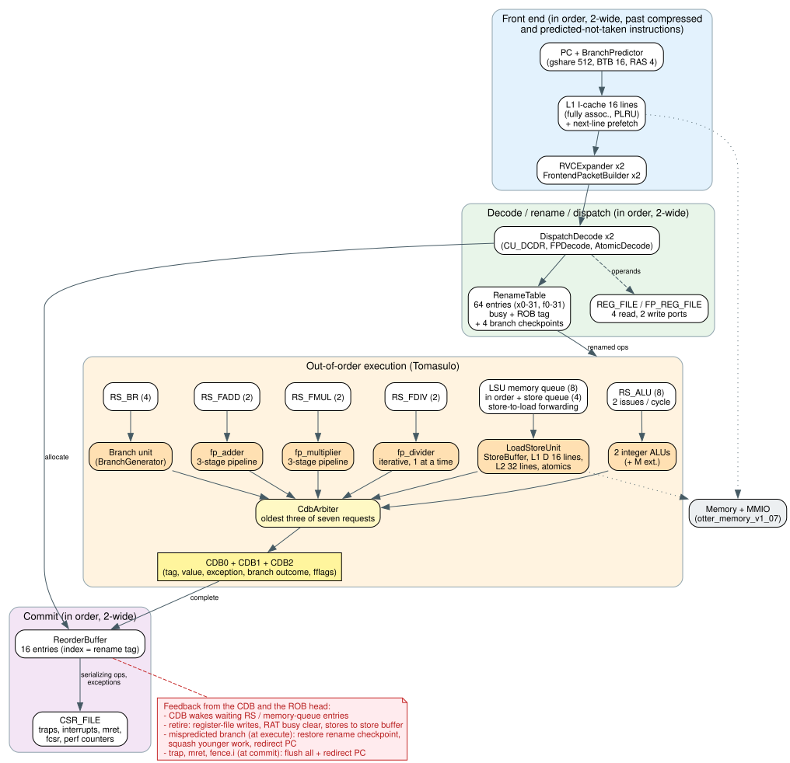
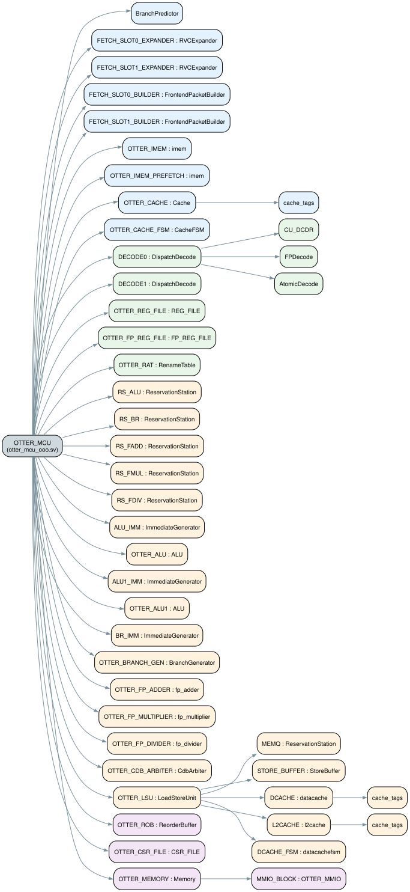

# RV32IMACZ

This repo contains a simulation-first RISC-V CPU built around a two-wide
out-of-order core (Tomasulo's algorithm with a reorder buffer) and a practical
verification flow. The current
software target is `rv32imac_zicsr_zifencei`, and the repo includes directed
tests, randomized tests, and a FreeRTOS + CoreMark demo.

## Project Overview

- Out-of-order core: two-wide in-order fetch/rename/dispatch, Tomasulo
  reservation stations, three common data buses, and a 16-entry reorder buffer
  for two-wide in-order commit with precise exceptions (see
  [Out-of-Order Core](#out-of-order-core))
- Execution units: two integer ALUs, branch unit, load/store unit, pipelined
  integer multiplier, iterative integer divider, pipelined FP adder, pipelined
  FP multiplier, iterative FP divider
- ISA support: RV32I, RV32M, RV32A, RV32C, `Zicsr`, `Zifencei`, and a
  single-precision F subset (`fadd/fsub/fmul/fdiv.s`, FP loads/stores, `fcsr`)
- Branch prediction: 512-entry gshare (8-bit global history) with backward-taken defaults for cold branches, a 16-entry BTB for indirect jumps, and a 4-entry RAS
- Fully associative caches with tree pseudo-LRU replacement: 16-line L1
  I-cache with next-line prefetch and 16-line L1 D-cache (32-byte lines),
  plus a store buffer; an optional 32-line L2 (build with `-DOTTER_L2`)
- Trap, CSR, timer-interrupt, and MMIO support
- Verification: every retired instruction compared against Spike (the
  reference RISC-V simulator) in lockstep, directed and constrained-random
  programs including an out-of-order stress mix, per-cycle checks of the
  out-of-order bookkeeping, unit tests, coverage aggregation, and GitHub
  Actions CI (see [Trying To Break The Out-Of-Order Core](#trying-to-break-the-out-of-order-core))
- Performance tracking: every core version measured on the same seven
  workloads in [`docs/PERFORMANCE.md`](docs/PERFORMANCE.md)

## Supported ISA

Current software target:

```text
rv32imac_zicsr_zifencei     (integer software, e.g. FreeRTOS + CoreMark)
rv32imafc_zicsr_zifencei    (FP tests; F is the subset listed below)
```

Implemented ISA pieces:

| Extension | Description |
| --- | --- |
| `RV32I` | Base 32-bit integer instruction set |
| `RV32M` | Integer multiply and divide |
| `RV32A` | Atomic instructions including `LR/SC` and AMOs |
| `RV32C` | Compressed 16-bit instruction support |
| `F` (subset) | Single-precision `fadd.s`, `fsub.s`, `fmul.s`, `fdiv.s`, `flw`, `fsw` (and `c.flw`, `c.fsw`, `c.flwsp`, `c.fswsp`), 32 FP registers, `fcsr`/`frm`/`fflags`, `mstatus.FS` |
| `Zicsr` | CSR read/modify/write instructions |
| `Zifencei` | Instruction-stream synchronization with `fence.i` |

Related system support included in the core:

- machine-mode CSR, trap, and `mret` handling (M-only hart: `mstatus.MPP`
  reads as M, `mtvec` is direct mode, `wfi` is a no-op)
- precise address-misaligned exceptions for loads, stores, and atomics
- IEEE-754 single precision: all five rounding modes (static or `frm`),
  subnormals, canonical NaNs, and all five exception flags; other F
  instructions (FMA, conversions, compares, moves) raise illegal-instruction
- timer interrupt support
- MMIO-backed software-visible I/O path
- verification workloads covering arithmetic, control flow, cache behavior,
  atomics, compressed instructions, CSR operations, traps, and `fence.i`

## Architecture Diagrams

Top-level block view of the core:

<p align="center">
  
</p>

Deeper module hierarchy view extracted from the RTL:

<p align="center">
  
</p>

## Learn The Project

1. `otter_mcu_ooo.sv` (module `OTTER_MCU`)
   Main core RTL: front end, rename/dispatch, execution units, CDBs, commit.
   The out-of-order building blocks are `ooo_pkg.sv`, `DispatchDecode.sv`,
   `RenameTable.sv`, `ReservationStation.sv`, `ReorderBuffer.sv`,
   `CdbArbiter.sv`, and `LoadStoreUnit.sv`.
2. `tb_core.sv`
   Main testbench, pass/fail behavior, and verification checks.
3. `test_files/asm/`
   Directed assembly tests used by the regression flow.
4. `tools/lockstep.py`, `tools/run_regression.sh`, `tools/run_random_tests.py`
   How the project is tested; `lockstep.py` compares the core against Spike,
   with programs from `test_files/lockstep/` and `tools/lockstep_random.py`.
5. `tools/perf_snapshot.py` and `docs/PERFORMANCE.md`
   How performance is measured and the history of every core version.
6. `software/freertos_coremark/`
   A small software workload that boots FreeRTOS and runs CoreMark in
   simulation.

Other useful files:

- `StoreBuffer.sv`, `datacache.sv`, `l2cache.sv` for the memory path;
  `cache_tags.sv` holds the shared fully associative tag/replacement logic
  (unit-tested by `tb_cache_tags.sv`)
- `BranchPredictor.sv`, `FrontendPacketBuilder.sv`, `RVCExpander.sv` for the
  front end
- `CSR_FILE.sv`, `AtomicDecode.sv` for system and atomic support (atomics
  execute in `LoadStoreUnit.sv`)
- `docs/diagrams/*.dot`: Graphviz sources of the diagrams above
- `board/zybo/` (top, pins, board testbench) and `board/uart.sv` for the Zybo Z7-20; `OTTER_Wrapper_v1_03.sv` and `Basys3_Master.xdc` are the original Basys 3 wrapper (the core no longer fits a Basys 3)

## How To Use It

### Prerequisites

- `python3`
- `iverilog` and `vvp`
- Optional: `verilator` for lint
- Optional: `spike` and GNU binutils (`riscv64-unknown-elf-as/ld/objcopy`)
  for the lockstep comparison and the assembler cross-check; both tools
  report `status=skipped` when these are missing
- Optional: `riscv64-unknown-elf-gcc` toolchain for the FreeRTOS + CoreMark
  example

Every flow compiles the RTL listed in `rtl.f` (`iverilog -c rtl.f`,
`verilator -f rtl.f`). `tools/build_sim.sh [out.vvp]` compiles the testbench
and hides Icarus's two "sorry" notices about SystemVerilog features it has not
implemented (constant selects in `always_*` blocks, `unique case`); they do not
affect results, and any other warning or error is still printed.

### Run The CPU On One Program

```bash
tools/build_sim.sh out/otter_tb.vvp
mkdir -p out/run && cp test_files/generated/rv32m.mem out/run/Test_All.mem
cd out/run && vvp -n ../otter_tb.vvp +PASS_SSEG=101
```

The testbench loads `Test_All.mem` from its working directory and ends with a
run report: pass/fail, cycles, retired instructions and IPC (from the core's
own `mcycle`/`minstret`), two-wide dispatch and commit share, dispatch
stalls, branch prediction accuracy, CDB contention, I-cache/D-cache/L2
behavior, store buffer, atomics, and traps.

| Option | Effect |
| --- | --- |
| `+PASS_SSEG=N` / `+FAIL_SSEG=N` | stop when the program writes N to the seven-segment register |
| `+MAX_CYCLES=N` | time out after N cycles |
| `+VERBOSE_COMMIT` / `+VERBOSE_LSU` | print every retired instruction, or store-buffer and atomic events |
| `+VERBOSE_MMIO` | print every MMIO write (LEDs, seven-segment) |
| `+COMMIT_LOG=file` | write the retirement trace used by `tools/lockstep.py` |
| `+STATS` | print machine-readable `TB FINAL/STATS/LSU/ATOM/OOO` lines instead of the report (used by the scripts) |

The directed assembly tests use the repo's own assembler script
`tools/assemble_tests.py`, so you do not need an external RISC-V assembler for
the normal regression flow.

### Run The Directed Regression Suite

```bash
bash tools/run_regression.sh
```

This rebuilds memory images from `test_files/asm/*.s`, runs the directed test
suite, and prints the last lines of each simulation run.

### Run The Lockstep Comparison Against Spike

```bash
python3 tools/lockstep.py --random 200
```

Each program in `test_files/lockstep/` (plus N seeded random programs from
`tools/lockstep_random.py`) is assembled with GNU `as` and run on both Spike
and the RTL. The testbench's `+COMMIT_LOG` trace is compared against Spike's
commit log: every retired instruction's PC, destination register and value,
and every memory write's address, data and size. The directed programs cover
every RV32IMAC/Zicsr/Zifencei instruction with edge operands, traps, CSRs,
misaligned accesses, and self-modifying code; the random programs stress
forwarding, dual issue, mixed 16/32-bit streams, store-buffer forwarding and
overflow, atomics, branch prediction, and traps in arbitrary pipeline states.

The checker was validated by mutation: planted bugs in the ALU, the bypass
priority, the load-use stall, the RVC expander, and store-buffer conflict
detection are all reported, and a performance-only predictor change is not.

`--profile ooo` switches the random programs to an out-of-order stress mix:
branches that resolve late (behind cache misses or FP divides) with both
paths full of squashable stores, loads, FP ops, and `fflags` accesses, plus
long dependency chains; `--length N` sets the program length:

```bash
python3 tools/lockstep.py --no-directed --profile ooo --length 1500 --random 500
```

The testbench also checks the out-of-order bookkeeping every cycle, so a bug
that happens not to change an architectural result still fails the run: ROB
occupancy, every busy rename-table entry against the ROB, every reservation
station operand still waiting (it must have a live, older, unfinished
producer), store-queue order, the load in flight, checkpoint owners, and the
three CDBs. A planted rename-table bug is caught on its first recovery. Any
`ASSERT_FAIL` fails the regression, random, and lockstep flows.

### Run The Randomized Tests

```bash
python3 tools/run_random_tests.py
```

This generates deterministic randomized programs that stress ALU behavior,
control flow, two-wide dispatch, store-buffer behavior, and atomic
operations, and runs the store-buffer, cache-tag, and FP-unit unit tests
(`tb_fpu_units.sv` checks the FP units against an exact-rational reference
model, `tools/fp_ref.py`).

### Run The Full Verification Flow

```bash
bash tools/run_verification_quality.sh
```

This runs the directed suite, randomized tests, report aggregation, the
assembler cross-check (`tools/check_assembler.py`: the repo's small assembler
against GNU `as`), and the Spike lockstep comparison. Logs and summary files
are written to:

```text
out/verification_logs/
```

The aggregated machine-readable summary is:

```text
out/verification_logs/verification_summary.json
```

### Run The FreeRTOS + CoreMark Demo

```bash
bash tools/run_freertos_coremark.sh
```

This builds the software image in `software/freertos_coremark/` (compiler
output is shown only on failure, or always with `VERBOSE=1`), runs it in a
scratch directory, and prints the run report. Extra testbench options can be
appended, e.g. `tools/run_freertos_coremark.sh +VERBOSE_MMIO`.

### Continuous Integration

`.github/workflows/verification.yml` runs on every push to `main` and on pull
requests: Verilator lint, then `tools/run_verification_quality.sh` with Spike
(built once at a pinned revision and cached). The runner is pinned to
`ubuntu-24.04`, whose packages provide Icarus Verilog 12.0 and Verilator
5.020, older than a typical local install, so the RTL avoids constructs those
versions reject or mis-simulate (see the bug list below). Every simulation has
a wall-clock limit, so a hang fails in minutes instead of using up the job's
hour. The CI environment can be reproduced locally with Docker:

```bash
docker run --rm -v "$PWD":/src:ro ubuntu:24.04 bash -c 'apt-get update && apt-get install -y iverilog verilator python3 gcc-riscv64-unknown-elf && cp -r /src /work && cd /work && bash tools/run_regression.sh'
```

### Record A Performance Snapshot

```bash
python3 tools/perf_snapshot.py --label "my change" --notes "what changed"
```

This runs FreeRTOS + CoreMark, the two system workloads, and four lockstep
kernels (integer, control, cache, FP) on the current RTL, records the run
reports in `docs/perf_history.json`, and regenerates `docs/PERFORMANCE.md`
(one column per snapshot, including dispatch-stall causes and mispredict
types). `--rtl-root DIR` measures another checkout on the same program images.

## Latest Verification Run

Run on October 21, 2026 on the out-of-order core (milestone 4) with
`bash tools/run_verification_quality.sh`:

- Directed regression suite: `23 / 23` passed
- Legacy randomized tests: store-buffer, cache-tag, and FP-unit unit tests
  plus `16 / 16` seeded programs
- Coverage report: 46 / 46 bins hit (47 with the optional L2)
- Assembler cross-check: 6,000 random instructions, 0 encoding mismatches
- Lockstep vs Spike: 14 directed + 200 random programs, ~144k retired
  instructions, 0 mismatches; across M4, an additional ~21,500 random
  programs (~12M instructions) also passed, plus the break-the-core
  campaigns below (~6,000 programs, ~5.4M instructions, invariants on)
- The same flow under CI's Icarus 12.0 (Ubuntu 24.04 container): all passed
- FreeRTOS + CoreMark: PASS
- Verilator lint: no RTL warnings (only `PROCASSINIT` style warnings in
  `tb_core.sv`)

### Bugs found in the in-order core by the lockstep flow (fixed October 2026)

- D-cache refill wrote zero into word 7 of the line (in L1 and L2) when the
  missing load was a sub-word load at a non-zero byte offset
- Atomics stalled in EX1 lost their forwarded operands once the producer
  retired, so LR/SC/AMO could use a stale address or data value
- `jalr` did not clear bit 0 of a target computed from an odd register
- `mepc` dropped bit 1, so a trap from a 2-byte-aligned PC returned to the
  wrong address under RV32C
- Misaligned loads/stores silently returned 0 or dropped the write, and
  misaligned atomics stopped the simulation; they now trap precisely
- `misa` omitted A and C; `mret` cleared `mstatus.MPP` instead of keeping M;
  writing `misa` and executing `wfi` raised illegal-instruction exceptions
- Reserved `SYSTEM` encodings (funct3=100, non-zero rs1/rd on
  ecall/ebreak/mret) executed instead of trapping
- `mret` and `fence.i` were not counted in `minstret`
- A trap could overtake an older in-flight `csrw` to `mcause`/`mtval`
- `tools/run_regression.sh` printed results but never failed on a failing test

## Running On A Zybo Z7-20

The core runs on a Digilent Zybo Z7-20 at 37.5 MHz with 64 KB of block RAM,
LEDs, switches, and a UART terminal on Pmod JE. The demo program
(`software/zybo_hello`) prints a banner, echoes what you type, and shows the
switches on the LEDs. In the Vivado Tcl Console:

```text
source tools/vivado/build_zybo.tcl
source tools/vivado/program_zybo.tcl
```

Wiring, the memory map, and running other programs:
[docs/BOARD_ZYBO.md](docs/BOARD_ZYBO.md). `tools/run_board_test.sh`
simulates the whole board with a terminal model.

## FPGA Synthesis Estimate

The core (`OTTER_MCU`, with the 64 KB memory and the two `imem` memory
models left out as black boxes, since they model external RAM and have more
ports than FPGA block RAM) was synthesized with Yosys `synth_xilinx` for
Xilinx 7-series after converting the SystemVerilog with `sv2v`:

| | Original | After the CDB arbiter rewrite |
| --- | ---: | ---: |
| LUTs | 131,016 | **90,742** |
| Flip-flops | 25,367 | 25,367 |
| DSP slices | 37 | 13 |
| `CdbArbiter` alone | 44,239 LUTs + 24 DSPs | 4,224 LUTs |

The original arbiter picked the oldest requests with integer loop variables
indexing the wide (about 170-bit) request records, which synthesized into
huge multiplexer chains. It now compares only the 4-bit ages once, ranks each
request, and selects the CDB records one-hot with an AND-OR. The rewrite was
proven equivalent to the old arbiter with a Yosys SAT miter (and a
million-vector simulation), and every workload keeps exactly the same cycle
count.

To open the core in the Vivado GUI on any machine, recreate the project from
the repository (the project itself is not committed: Vivado projects hold
absolute paths and machine-specific caches):

```bash
vivado -source tools/vivado/create_project.tcl
```

This builds `vivado/otter_core/otter_core.xpr` for the Zybo Z7-20 board
design (top `zybo_top`, pin constraints, the demo program in the
memories, `tb_zybo` as the simulation top) and opens the elaborated design;
Run Synthesis, Run Implementation, and Generate Bitstream then work from
the GUI. Options go after `-tclargs`: `core=1` for the core alone
(`OTTER_MCU`, out of context), `program=<file>` for another memory image,
`elaborate=0` to only create the project.

To get Vivado's numbers and timing for the core alone against the 50 MHz
goal, synthesize it out of context (no board, no pins); on Windows or Linux,
from the repository root:

```bash
vivado -mode batch -source tools/vivado/synth_core.tcl
```

The top is `OTTER_MCU`, the part defaults to the Zynq-7020 on the Zybo
Z7-20 (`xc7z020clg400-1`; pass another part with `-tclargs`), the clock target is
50 MHz (`tools/vivado/core_ooc.xdc`). The console ends with a summary
(resources, worst slack, estimated maximum clock, the five worst paths), and
the full utilization and timing reports land in `reports/vivado/<part>/`,
which is tracked, so a `git push` from the Vivado machine shares them.

The first Vivado run (before milestone 5, synthesis only) reported 52,826
LUTs (39% of the 200T), 33,595 flip-flops, 10 DSP slices, and a worst setup
slack of -101.7 ns at 50 MHz: about 8 MHz. After milestone 5, Yosys reports
83,859 LUTs (from 90,742), 27,114 flip-flops, and 6 DSP slices; rerun the
script for Vivado's post-route numbers.

Post-route on the Artix-7 200T (after milestone 5 and the fixes in
[docs/TIMING_CLOSURE_PLAN.md](docs/TIMING_CLOSURE_PLAN.md)): 51,069 LUTs,
35,529 flip-flops, 6 DSP slices, 37.9 MHz. To fit the Zybo Z7-20 (Zynq-7020:
53,200 LUTs, 106,400 flip-flops), the ROB keeps its allocation-only fields
in LUT RAM (Vivado had it at 15,644 LUTs) and the L2 became optional and
off, since on-chip block RAM refills a line as fast as the L2 did; neither
changed any workload's cycle count. Estimated from Vivado's per-module
numbers: about 34,000 LUTs; Vivado measured 41,808 LUTs (79% of the 7020)
and 23,600 flip-flops post-route, closing at 39.6 MHz. All core logic, caches included, now runs on
the rising edge (see [docs/TIMING_CLOSURE_PLAN.md](docs/TIMING_CLOSURE_PLAN.md)).
The memories are synchronous block RAM (`imem.sv`, `otter_memory_v1_07.sv`),
the same RTL in simulation and on the FPGA.

## Trying To Break The Out-Of-Order Core

After the out-of-order core was finished (milestones 1-4), it was attacked on
purpose, looking for bugs the normal flows might miss. No bug in the shipped
core was found.

| Attack | What it targets | Scale | Result |
| --- | --- | --- | --- |
| Per-cycle invariant checker (in `tb_core.sv`) | Bookkeeping bugs that happen not to change an architectural result | Every cycle of every run below | No violations |
| Random lockstep programs, default mix | Everything, compared against Spike instruction by instruction | 3,000 programs, 1.7M instructions | All match Spike |
| `--profile ooo` stress mix, 1,500-instruction programs | Branches that resolve late (behind D-cache misses or FP divides) with both paths full of stores, loads, FP ops, `fflags` accesses, and nested branches; long ALU/M/load dependency chains | 2,000 programs, 2.7M instructions | All match Spike |
| Shrunk hardware: ROB 8, branch RS 2, ALU RS 2, memory queue 2, store queue 2, store buffer 2 | Full, stall, and wrap-around corners that the shipped sizes reach only rarely | 14 directed + 1,000 stress programs, 0.96M instructions | All match Spike |
| CI toolchain (Icarus 12, Verilator 5.020) with the checker on | Simulator-version differences | Full verification flow | All pass, lint clean |

The invariant checker verifies, every cycle:

- ROB: the occupancy count matches the valid entries, all inside the window
- Rename table: every busy register names a live ROB entry that writes it
- Reservation stations and the memory queue: every entry belongs to a live,
  unfinished ROB entry, and every operand still waiting names a live,
  unfinished, older producer, so no wake-up can be lost
- Store queue: live stores only, in program order
- The load in flight, unless squashed, belongs to a live, unfinished load
- Checkpoints: held only by live, unresolved branches
- CDBs: each broadcasts a live, unfinished entry, never two the same tag

It was validated by mutation: with the rename-table restore on a mispredict
disabled, it reports stale mappings on the very first recovery. Any
`ASSERT_FAIL` now fails the regression, random, and lockstep flows (before,
the regression only looked for `TB PASS`).

One limitation turned up: a reservation station with a single entry does not
simulate (its valid bit is never reset in Icarus), so 2 is the minimum
station size. The shipped design uses 2 or more everywhere.

Reproduce the campaigns with:

```bash
python3 tools/lockstep.py --no-directed --random 3000 --seed-base 900000
python3 tools/lockstep.py --no-directed --profile ooo --length 1500 --random 2000
```

### Bugs found while building the out-of-order core

Each was caught by the verification flow before the milestone was reported:

- M1: the testbench logged a retired register by reading the register file,
  which slot 1 had already overwritten when both commit slots wrote the same
  register in one cycle (a checker bug, not an RTL bug)
- M1: two performance counters (fence wait, store-ordering stall) no longer
  counted anything once fences and loads waited in new places
- M2: a deadlock (1 random program in about 2,500): in a recovery cycle the
  LSU output buffer handed a younger result to the CDB, an older load filled
  the freed buffer in the same cycle, and the squash then erased the older
  load's result
- M4: the first gshare version predicted every cold branch taken, slowing
  short programs (and polluting the I-cache with wrong-path fetches); cold
  backward branches are now predicted taken and cold forward ones not taken
- M4: a store-buffer drain rule from the in-order core held back drains
  during store bursts and filled the buffer; removing it also made one
  directed test's expectation (a full buffer) obsolete
- M4 option 5: a faulting FP CSR access (FS off) took the new fast path and
  never completed
- CI only (Icarus 12 / Verilator 5.020): `always_comb` blocks sharing a
  function, or reading their own outputs, re-triggered each other forever at
  time 0 (the FP-subset commit's CI run hit the 1-hour limit); `break` and
  `continue` were rejected; a local array in `always_comb` crashed the
  simulator; Verilator could not unroll a 512-entry reset loop or the
  64 x 4 checkpoint update loop

## Project Layout

- Root `*.sv` files: core RTL, caches, MMIO, predictor, and testbenches
- `rtl.f`: the RTL file list shared by every simulation and lint flow
- `test_files/asm/`: hand-written directed assembly tests
- `test_files/lockstep/`: directed programs for the Spike lockstep flow
- `test_files/generated/`: generated `.mem` images used in simulation
- `tools/`: build, test, reporting, performance, and helper scripts
- `docs/`: `PERFORMANCE.md` and `perf_history.json` (performance history),
  `diagrams/` (Graphviz sources), `images/` (rendered diagrams)
- `.github/workflows/verification.yml`: the CI workflow
- `software/freertos_coremark/`: FreeRTOS + CoreMark software example
- `third_party/`: vendored FreeRTOS and CoreMark sources

## Current Status

The current design is a two-wide out-of-order RV32IMAC core with a
single-precision FP subset, atomics, compressed instructions, gshare branch
prediction with early recovery, store-to-load forwarding, CSR/trap support,
a store buffer, and a two-level fully associative cache hierarchy. On
FreeRTOS + CoreMark it runs at IPC 1.107 (21% fewer cycles than the
dual-issue in-order core it replaced). Milestone 5 restructured it for FPGA
clock speed, trading about 8% IPC for a much shorter critical path; the
post-route Vivado measurement of that clock speed is the next step. The repo
also includes the verification flows above and a software bring-up path so
the project is easier to study and extend.

Possible next steps: a non-blocking D-cache (several outstanding misses) and
a stride prefetcher, return-stack repair on mispredicts, a larger ROB, or a
second hart with coherent caches.

## Floating-Point Units

| Unit | Instructions | Structure | Latency | Throughput |
| --- | --- | --- | --- | --- |
| `fp_adder.sv` | `fadd.s`, `fsub.s` | 3-stage pipeline (align / add+normalize / round) | 3 cycles | 1 per cycle |
| `fp_multiplier.sv` | `fmul.s` | 3-stage pipeline (unpack / 24x24 multiply / normalize+round) | 3 cycles | 1 per cycle |
| `fp_divider.sv` | `fdiv.s` | iterative restoring divider, 1 quotient bit per cycle | 28 cycles (1 setup + 27 quotient bits) | 1 at a time |

Each unit has its own reservation station. The adder and multiplier accept a
new operation every cycle and hold their pipeline only when their result
loses CDB arbitration; the divider takes one operation at a time while other
units keep executing around it.

Verification: `tb_fpu_units.sv` checks the three units against an
exact-rational reference model (`tools/fp_ref.py`, 150,000 vectors), and the
lockstep flow checks the integrated core against Spike with
`test_files/lockstep/fp_arith.s` (300 operand pairs through every operation
and rounding mode, generated by `tools/gen_fp_lockstep.py`),
`test_files/lockstep/fp_system.s` (FS gating and transitions, FP CSRs,
traps, compressed FP loads/stores, dependencies), and random programs that
mix FP with all other traffic.

## Out-of-Order Core

| Structure | Size | Notes |
| --- | --- | --- |
| Fetch / dispatch / commit width | 2 / 2 / 2 | in order; slot 1 is fetched behind compressed and unaligned instructions and behind a branch predicted not-taken; slot 1 commits only simple instructions alongside slot 0 |
| Reorder buffer | 16 entries | the ROB index is the rename tag |
| Rename table | 64 entries | x0-x31 and f0-f31: busy bit + ROB tag |
| Integer ALU RS | 8 | issues the two oldest ready entries to two ALUs, which execute next cycle from registers |
| Integer multiply / divide RS | 2 / 2 | 3-stage pipelined multiplier (DSP slices); iterative radix-2 divider (about 35 cycles) |
| Branch RS | 4 | branches, `jal`, `jalr`; each holds one rename-table checkpoint |
| Memory queue / store queue | 8 / 4 | in order; stores wait in the store queue until commit and forward to younger loads |
| FP add / mul / div RS | 2 / 2 / 2 | |
| Common data buses | 3 | ALU 0, ALU 1, and the branch unit own CDB 0, 1, and 2 when they execute; `CdbArbiter` gives the free buses to the oldest of the other seven units' results |
| Branch predictor | 512 + 16 + 4 | gshare counters (halfword-indexed) XOR 8-bit speculative history, repaired on a mispredict; branch and `jal` targets computed at fetch; BTB for other `jalr`; RAS for returns |

Operands are read at dispatch from the register files or the ROB (finished
results); otherwise the RS entry waits for the producer's tag, and also
checks the CDBs as it is written, so a value broadcast in the dispatch cycle
is not missed. Each station selects in one cycle and its unit executes in the
next, from a register. To keep dependent ALU instructions issuing back to
back, a selected ALU instruction broadcasts its tag at once (a speculative,
tag-only wake-up): waiting consumers in the ALU, branch, and multiplier
stations become ready the next cycle, which is exactly when the ALU drives
the value on its own CDB, and take it from there. CSR accesses, atomics, fences, `mret`, and `wfi`
serialize: they dispatch into an empty ROB and execute as they commit. FP CSR
accesses that cannot change the rounding mode (any `fflags` access, and
reads of `frm`/`fcsr`) do not: they dispatch normally, read the CSR when they
reach the ROB head (after every older FP operation has accrued its flags),
and broadcast the value on a CDB to wake their dependents.
Exceptions, interrupts, `mret`, and `fence.i` are handled at the ROB head
with a full flush, so all state changes are precise.

Branch recovery happens at execute. Each branch or jump saves a checkpoint
of the rename table at dispatch (commits keep clearing busy bits inside the
checkpoints). When it resolves as mispredicted, in the cycle it executes,
fetch is redirected, the rename table is restored from the checkpoint, and
everything younger is squashed: the ROB tail, reservation-station and
memory-queue entries, the store-queue tail, the load in flight, the LSU
output buffer, FP and integer-multiply pipeline stages (live bits), and a
running FP or integer divide. Older
work keeps executing. The branch predictor's BHT and BTB train at commit;
the RAS updates at dispatch.

Loads use store-to-load forwarding. The memory queue is in order, so when a
load reaches its head every older store is already in the store queue with
its address and data. The youngest overlapping store forwards its data if it
covers every byte the load reads (the load completes without a cache
access); a partial overlap waits for those stores to commit; a load with no
overlapping store goes straight to the store buffer and caches. MMIO loads
still wait for all older stores, keeping device accesses in program order.

Milestones: M1 Tomasulo back end, M2 early branch recovery, M3 store-queue
forwarding, M4 tuning, M5 FPGA timing closure (all done; see the performance
section and [`docs/TIMING_CLOSURE_PLAN.md`](docs/TIMING_CLOSURE_PLAN.md)). Ideas not
done: return-stack repair on mispredicts, and a 32-entry ROB (ROB-full
stalls are about 9k cycles of FreeRTOS + CoreMark).

## Performance Snapshots

[`docs/PERFORMANCE.md`](docs/PERFORMANCE.md) tracks every core version on the
same seven workloads (FreeRTOS + CoreMark, the two system workloads, and four
lockstep kernels including FP), with cycles, IPC, branch, cache, and
store-buffer numbers per snapshot. A new snapshot is recorded after each
feature:

```bash
python3 tools/perf_snapshot.py --label "OoO M2" --notes "early branch recovery"
```

`--rtl-root DIR` measures another tree (for example an export of `main`) on
the same program images.

### Out-of-Order Core, Milestone 5: FPGA Timing Closure (October 2026)

The design ran at about 8 MHz on an FPGA (Vivado, Artix-7 200T): one clock
cycle held a whole out-of-order step, from picking an instruction through a
single-cycle 32-bit divide to broadcasting and capturing the result (a
337-level path). Milestone 5 split that chain; see
[`docs/TIMING_CLOSURE_PLAN.md`](docs/TIMING_CLOSURE_PLAN.md) for the plan,
measurements, and results.

| Step | Change | FreeRTOS + CoreMark cycles | IPC |
| --- | --- | ---: | ---: |
| Before | | 275,491 | 1.207 |
| 1 + 2 | Iterative integer divider and 3-stage pipelined multiplier as their own units | 281,339 | 1.182 |
| 3 | Select and execute in separate cycles; ALUs and branch unit own their CDBs; speculative tag wake-up keeps dependent ALU operations back to back | 300,374 | 1.107 |
| 4 | Register files write on the rising edge | 300,374 | 1.107 |

Together the steps cost 9% of the cycles (8% IPC) on FreeRTOS + CoreMark, in
exchange for a much shorter clock period: the longest path in the Yosys
logic-depth proxy fell from 267 to 44 LUT levels. Vivado post-route timing
gives the real clock speed (see [FPGA Synthesis Estimate](#fpga-synthesis-estimate)).
The first Vivado synthesis after these steps measured -17.1 ns of slack at
50 MHz (about 27 MHz, from 8 MHz); its worst path was instruction selection,
which was then rewritten as parallel age compares and proven equivalent to
the old selection with a Yosys sequential equivalence check.
A measured trade-off: the small `system_workload` programs and the
divide-heavy `rv32im_alu` test now take more cycles than on the old in-order
core (932 vs 902, 1,040 vs 984, 14,504 vs 5,586), while FreeRTOS + CoreMark
still takes 21% fewer.

### Out-of-Order Core, Milestone 4: Tuning (October 2026)

Each option was measured on its own (`docs/PERFORMANCE.md` has every counter
for every step) and validated against Spike (thousands of random programs per
step) and in the CI container (Icarus 12) before the next one.

| Step | Change | FreeRTOS + CoreMark cycles | IPC |
| --- | --- | ---: | ---: |
| In-order dual-issue core | | 379,141 | 0.877 |
| OoO M3 (start of M4) | | 369,375 | 0.900 |
| 0 | dispatch-stall attribution counters (testbench only) | 369,375 | 0.900 |
| 1 | gshare predictor, branch targets at fetch, BTFN for cold branches | 352,921 | 0.942 |
| 2 | branch RS and checkpoints 2 -> 4 | 350,240 | 0.950 |
| 6 | store buffer drains every cycle (depth 8 measured: no gain) | 345,430 | 0.963 |
| 3 | slot 1 behind compressed/unaligned instructions; past not-taken branches | 315,867 | 1.053 |
| 4 | second integer ALU, 8-entry ALU RS, third CDB | **275,491** | **1.207** |
| 5 | FP CSR accesses (`fflags`, `frm`/`fcsr` reads) no longer serialize | 275,491 | 1.207 |

| Workload | In-order | OoO M3 | OoO M4 |
| --- | ---: | ---: | ---: |
| FreeRTOS + CoreMark | 379,141 | 369,375 | **275,491** (-27.3%) |
| `system_workload` | 902 | 941 | **805** (-10.8%) |
| `system_workload_benchmark` | 984 | 1,022 | **901** (-8.4%) |
| `rv32im_alu` | 5,586 | 6,865 | **3,856** (-31.0%) |
| `rv32i_control` | 1,024 | 1,031 | **801** (-21.8%) |
| `cache_stress` | 4,271 | 4,057 | **4,031** (-5.6%) |
| `fp_arith` | 86,804 | 93,138 | **51,620** (-40.5%) |

(Percentages are against the in-order core.) What the measurements showed:
81% of mispredicts were taken branches missing in the 8-entry BTB, so branch
targets are now computed from the instruction; branch-RS-full stalls were
mostly branches waiting on loads (8 entries only moved the stall to the
memory queue); the store buffer never needed more entries, just to stop
holding back drains during store bursts; and the largest single limit was
fetch, which filled slot 1 only behind a word-aligned 32-bit instruction;
and `fp_arith`, which reads `fflags` after almost every FP operation, was
throttled by CSR serialization until option 5 (FreeRTOS has no FP, so that
step leaves it unchanged). Every workload is now faster than on the in-order
core.

### Out-of-Order Core, Milestone 3: Store-to-Load Forwarding (October 2026)

| Workload | Metric | In-order dual-issue | OoO M1 | OoO M2 | OoO M3 |
| --- | --- | ---: | ---: | ---: | ---: |
| FreeRTOS + CoreMark | cycles | 379,141 | 397,592 | 375,765 | **369,375** |
| FreeRTOS + CoreMark | IPC | 0.877 | 0.837 | 0.885 | **0.900** |
| FreeRTOS + CoreMark | store-ordering stall cycles | 0 | 9,077 | 9,065 | 3 |
| `cache_stress` | cycles | 4,271 | 4,696 | 4,555 | **4,057** |
| `system_workload` | cycles | **902** | 1,001 | 964 | 941 |
| `system_workload_benchmark` | cycles | **984** | 1,102 | 1,058 | 1,022 |

Almost every M1/M2 store-ordering stall was a load waiting behind an older
store to a different address; those loads now issue at once, and loads that
read a just-stored value take it from the store queue. The out-of-order core
now leads the in-order one by 2.6% on FreeRTOS + CoreMark and 5.0% on
`cache_stress`. It still trails on integer-only code (one integer ALU:
`rv32im_alu` IPC 0.998 vs 1.227), on `fp_arith` (frequent `frm`/`fflags`
CSR accesses serialize the ROB), and slightly on the small system workloads.

### Out-of-Order Core, Milestone 2: Early Branch Recovery (October 2026)

| Workload | Metric | In-order dual-issue | OoO M1 | OoO M2 |
| --- | --- | ---: | ---: | ---: |
| FreeRTOS + CoreMark | cycles | 379,141 | 397,592 | **375,765** |
| FreeRTOS + CoreMark | IPC | 0.877 | 0.837 | **0.885** |
| `system_workload` | cycles | **902** | 1,001 | 964 |
| `system_workload_benchmark` | cycles | **984** | 1,102 | 1,058 |
| `rv32i_control` | cycles | **1,024** | 1,140 | 1,031 |

Recovering at execute instead of commit cuts FreeRTOS + CoreMark by 5.5%,
which puts the out-of-order core ahead of the in-order one there. The small
system workloads remain behind: their loads still wait for older stores
(M3), and integer-only code is limited by the single integer ALU. Mispredict
counts can rise slightly versus M1 because wrong-path branches now resolve
and recover before an older branch squashes them.

### Out-of-Order Core, Milestone 1 (October 2026)

| Workload | Metric | In-order dual-issue (before) | Out-of-order M1 |
| --- | --- | ---: | ---: |
| FreeRTOS + CoreMark | cycles | **379,141** | 397,592 |
| FreeRTOS + CoreMark | IPC | **0.877** | 0.837 |
| `system_workload` | cycles | **902** | 1,001 |
| `system_workload_benchmark` | cycles | **984** | 1,102 |

Milestone 1 is about correctness, and it is slower than the in-order core it
replaces: a mispredicted branch is recovered only when it reaches the ROB
head (11,824 mispredicts in the FreeRTOS run), and loads wait until every
older store has committed (9,077 such stall cycles). Those are the two
planned next milestones.

### Fully Associative Caches (October 2026)

The L1 I-cache, L1 D-cache, and L2 changed from 2-way set associative (LRU)
to fully associative, sharing one tag/replacement module (`cache_tags.sv`).
Both tree pseudo-LRU and true LRU were implemented and measured; pseudo-LRU
is the default, and `IVERILOG_FLAGS=-DOTTER_TRUE_LRU` selects true LRU.

| Workload | Metric | 2-way LRU (before) | FA pseudo-LRU | FA true LRU |
| --- | --- | ---: | ---: | ---: |
| FreeRTOS + CoreMark | cycles | 381,132 | **379,141** | 379,407 |
| FreeRTOS + CoreMark | I-cache line fills | 2,178 | **890** | 1,049 |
| FreeRTOS + CoreMark | D-cache misses | **1,018** | 1,080 | 1,074 |
| FreeRTOS + CoreMark | misses served by L2 | 598 | 583 | **661** |
| `system_workload` | cycles | 910 | 902 | **900** |
| `system_workload_benchmark` | cycles | 993 | 984 | **982** |

Replacement-logic cost (Yosys generic synthesis of `cache_tags`, one lookup
port): 16 lines, 2,295 cells for pseudo-LRU vs 2,872 for true LRU (15 vs 64
replacement-state bits); 32 lines, 4,660 vs 6,106. With performance within
0.2% either way, pseudo-LRU is about 20-24% smaller, so it is the default.

Verification: `tb_cache_tags.sv` checks both policies against independent
reference models (20,000 random operations); the lockstep flow
(`test_files/lockstep/cache_stress.s` plus 1,000 random programs) and the
full regression pass for both policies.

These snapshots are kept here so the project history stays visible.

### Historical Comparison

Captured on March 27, 2026 before the `IF1` / `IF2` split:

| Workload | Metric | Old 5-stage core | 6-stage predicted core | + store buffer core | 7-stage dual-issue core |
| --- | --- | ---: | ---: | ---: | ---: |
| `system_workload` | TB completion cycles | 1047 | 1034 | 1027 | 952 |
| `system_workload` | `flush_id` | 110 | 54 | 54 | 63 |
| `system_workload` | `flush_ex` | 131 | 111 | 111 | 120 |
| `system_workload_benchmark` | TB completion cycles | 1141 | 1113 | 1113 | 1049 |
| `system_workload_benchmark` | benchmark-window cycle delta (`last_leds`) | 804 | 800 | 800 | 759 |
| `system_workload_benchmark` | `flush_id` | 116 | 56 | 56 | 68 |
| `system_workload_benchmark` | `flush_ex` | 160 | 124 | 124 | 136 |

### 7-Stage Dual-Issue Snapshot

Captured on March 28, 2026:

| Workload | Metric | 7-stage dual-issue core RV32IMA |
| --- | --- | ---: |
| `system_workload` | TB completion cycles | 952 |
| `system_workload` | `flush_id` | 63 |
| `system_workload` | `flush_ex` | 120 |
| `system_workload_benchmark` | TB completion cycles | 1049 |
| `system_workload_benchmark` | benchmark-window cycle delta (`last_leds`) | 759 |
| `system_workload_benchmark` | `flush_id` | 68 |
| `system_workload_benchmark` | `flush_ex` | 136 |

### Current RV32IMAC Snapshot

Rerun on April 15, 2026:

| Workload | Metric | 7-stage RV32IMA core |
| --- | --- | ---: |
| `system_workload` | TB completion cycles | 914 |
| `system_workload` | `flush_id` | 36 |
| `system_workload` | `flush_ex` | 93 |
| `system_workload_benchmark` | TB completion cycles | 999 |
| `system_workload_benchmark` | benchmark-window cycle delta (`last_leds`) | 713 |
| `system_workload_benchmark` | `flush_id` | 37 |
| `system_workload_benchmark` | `flush_ex` | 105 |

### Post-Verification Snapshot

Rerun on October 15, 2026 after the bug fixes above (MRET and FENCE.I now
retire through the pipe instead of being killed in EX1):

| Workload | Metric | Before | After |
| --- | --- | ---: | ---: |
| `system_workload` | TB completion cycles | 914 | 910 |
| `system_workload` | `flush_ex` | 93 | 88 |
| `system_workload_benchmark` | TB completion cycles | 999 | 993 |
| `system_workload_benchmark` | `flush_ex` | 105 | 98 |

FreeRTOS + CoreMark (10 iterations, GCC 16.1 `-O2`) on the same RTL:
PASS at cycle 381,132; 332,588 instructions retired (IPC 0.873); 84.9% of
control-flow instructions predicted correctly; I-cache 99.3% and D-cache
98.2% hit rate; 4.4% of instructions retired from the second issue slot.

### FreeRTOS + CoreMark Smoke Snapshot

Captured during the April 2026 software bring-up:

- `system_workload`: 914 TB completion cycles
- `system_workload_benchmark`: 999 TB completion cycles
- FreeRTOS/CoreMark simulation pass code: `201`
